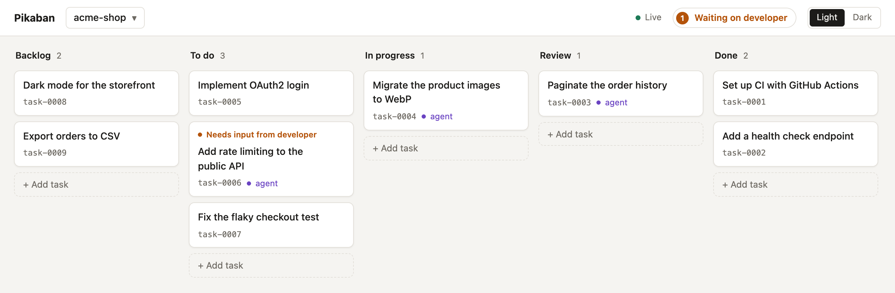

<p align="center"></p>

# pikaban

## Human written block for you

Tell your agent “add a task for that” and come back to it later: a tiny task tracker that lives in your project as Markdown files.

<picture>
  <source media="(prefers-color-scheme: dark)" srcset="assets/board-dark.png">
  
</picture>

### Features

- Capture mid-session: ask the agent to add an idea; no context switch to a cloud tracker.
- Lives in the project: Markdown files in `.pikaban/`, committed, shared and moved with the repo.
- No integration: the agent uses a small CLI and plain files. No MCP server, API or account.
- Just enough: add, edit, move, delete. Ask the agent, or do it on the local board in the browser.
- Ask the agent to do a task (or the whole todo list); when something is unclear, it writes questions into the task and waits for your answers.
- Switch between your projects on the board.

### Setup

Needs Node.js 20 or later.

```sh
npm install -g pikaban

# init in your project
cd my-project
pikaban init

# open the Kanban board in the browser:
pikaban ui
```

For agents other than Claude Code, ask yours to make a pikaban skill from [AGENT_GUIDE.md](AGENT_GUIDE.md).

### Use

Ask your agent, for example:

```text
> Add a task "Implement OAuth2 login", describe popular providers and the flow
> Do task 1
> Work through the todo list
```

## AI slop for your agent

Give your agent [AGENT_GUIDE.md](AGENT_GUIDE.md) and ask it anything about pikaban.
